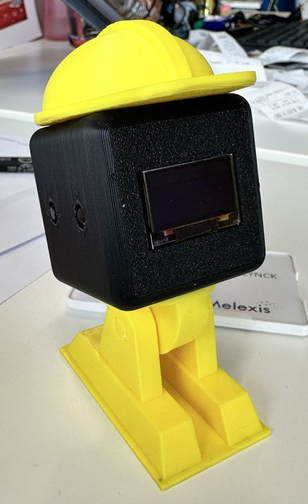

# STEM Club — MicroPython Workshop

## Welcome!

When you sit down, look at the screen on your board. It says **"Hello, <NAME>!"**. The board doesn't know your name yet. Your first job is to teach it!

After that, you will build three things:

1. **Robot Eyes** — animated eyes on the screen that react to buttons
2. **Musical Buzzer** — compose your own song and play it with a button
3. **WiFi Robot** — control the robot from your phone over WiFi

Finished early? There's an optional fourth one: **design a hat for your robot** and get it 3D printed!

You will write code in **MicroPython** — a version of Python that runs on tiny computers like your ESP32. The boards are already set up and ready to go. No installation needed.

---

## Your hardware

| Part | What it does |
|------|-------------|
| **ESP32** | The brain — a tiny computer running your Python code |
| **OLED screen** | A small display with a yellow strip at the top and blue area below |
| **Buzzer** | Makes sounds |
| **Button 1** | Left button |
| **Button 2** | Right button |

---

## How to edit and upload code — using Thonny

**Thonny** is a beginner-friendly code editor that talks directly to your ESP32. Here is how to use it:

### 1. Open Thonny

Look for **Thonny** in your application menu, or type `thonny` in the terminal.

### 2. Connect to your board

At the bottom-right corner of the window you will see the interpreter. Click it and choose:

> **MicroPython (ESP32)** — then select the correct port (your tutor will help)

The bottom panel will show `>>>` — that means Thonny is talking to your board.

### 3. Open the file panel

Go to **View → Files**. Two panels appear:
- **Top panel** — files on this computer
- **Bottom panel** — files on your ESP32

### 4. Edit your code

In the bottom panel (ESP32), double-click **main.py** to open it. Make your changes in the editor.

### 5. Save and run

Press **Ctrl + S** to save your changes directly to the board.
Then press the **Stop/Restart** button (or press **F5**) to run your updated code.

That's it! The only time you use the terminal is to load a new exercise, and you do that together with your tutor.

---

## Warm-up — put your name on the screen 👋

1. In Thonny, open **main.py** from the ESP32 (bottom panel).
2. Find this line:
   ```python
   NAME = "<NAME>"  # <-- change this to your name
   ```
3. Replace `<NAME>` with your first name. **Keep the quote marks `" "`!**
   ```python
   NAME = "Henry"  # <-- change this to your name
   ```
4. Press **Ctrl + S** to save, then **F5** to run.

✅ **It worked if:** the screen says **Hello, Henry!**, with your name.

> 💡 The screen fits about 15 letters, and it can't show accents (é, ë…). Use your first name, written without accents.

---

## Exercise 1 — Robot Eyes 👀

### ✋ Before you start — load the Exercise 1 code

**Wait for your tutor.** We do this step all together, or your tutor helps you.

1. Open a terminal in the workshop folder (`STEM_ESP32_ROBOT`) and type:
   ```bash
   git checkout robo_eyes_exercise
   ```
2. In Thonny, double-click **main.py** in the **top panel** (this computer).
3. Click **File → Save as… → MicroPython device** and save it as **main.py** (say yes to replace the old one).
4. Press **Stop/Restart** (or **F5**).

✅ **It worked if:** two robot eyes appear in the blue part of the screen and blink.

### What you will build

Animated robot eyes on the OLED screen that show a mood you choose.

### Walk through the code

Open **main.py** from the ESP32 in Thonny and read through it from top to bottom. Here is what each section does:

**1. Imports** — load the libraries that give us the screen and eye animation.

**2. Screen setup** — connect to the display over two wires (SDA and SCL) and set up the drawing area.

**3. Robot eyes setup** — create the animation and tell it to blink automatically.

**4. Your turn** — one line to change (see below).

**5. Main loop** — runs forever, drawing the next animation frame.

---

### Your task — choose an emotion

Find this line at the bottom of the setup:

```python
EMOTION = DEFAULT   # <-- change this!
```

Replace `DEFAULT` with one of these:

| Name | What it looks like |
|------|--------------------|
| `DEFAULT` | Calm, neutral eyes |
| `HAPPY` | Big, round friendly eyes |
| `TIRED` | Droopy eyelids |
| `ANGRY` | Frowning, narrowed eyes |
| `CURIOUS` | One eye bigger than the other |

> 💡 Type the emotion in **CAPITALS**, exactly like in the table: `HAPPY`, not `happy`. Python sees those as two different words.

Save (**Ctrl + S**) and restart. See the eyes change!

---

### Part 2 — add buttons (type this yourself!)

Now you will wire two buttons and make them switch emotions. Your tutor will help you connect the buttons to the board.

**How does a button work?**

Every pin on the ESP32 reads a **digital signal** — a value that is always either:

- **1** (HIGH) — the pin has voltage (~3.3 V)
- **0** (LOW) — the pin has no voltage (0 V, same as GND)

A button is a simple switch. It connects two points together when pressed.
Where you connect the other leg of the button decides what signal you read:

| Other leg connected to | Not pressed | Pressed |
|------------------------|-------------|---------|
| VCC (3.3 V) | 0 | **1** |
| GND (0 V)   | 1 | **0** |


Our buttons are wired to **GND**. The ESP32 has a built-in pull-up resistor that holds the pin at **1** when the button is open.

**Step 1 — Type this code** on the empty line just above `# --- Main loop ---`:

```python
button1 = Pin(16, Pin.IN, Pin.PULL_UP)   # left button
button2 = Pin(17, Pin.IN, Pin.PULL_UP)   # right button

PRESSED = ???      # <-- 0 or 1? think about the wiring!
EMOTION_1 = HAPPY
EMOTION_2 = ANGRY
```

Now replace `???` with **0** or **1**. Which one is right? Look at the table above. Our buttons are wired to **GND**.

> ⚠️ Did you choose `HAPPY` or `ANGRY` in Part 1? Then that button will look like it does nothing, because the eyes already look like that! Change `EMOTION_1` or `EMOTION_2` to a different emotion.

**Step 2 — Switch on the button code.** At the bottom of the file, inside the loop, you'll find these lines:

```python
    #if button1.value() == PRESSED:
    #    robo.mood = EMOTION_1
    #if button2.value() == PRESSED:
    #    robo.mood = EMOTION_2
```

The `#` turns a line off, so the computer skips it. Remove **only the `#`** at the start of each of the 4 lines. Don't delete any spaces, because the spaces tell Python which lines belong together.

Save and restart. Press the buttons!

### Stuck?

Your tutor can switch you to the `robo_eyes_solution` branch where the full solution is ready.

---

## Exercise 2 — Musical Buzzer 🎵

### ✋ Before you start — load the Exercise 2 code

**Wait for your tutor.** We do this step all together, or your tutor helps you.

1. Open a terminal in the workshop folder (`STEM_ESP32_ROBOT`) and type:
   ```bash
   git checkout musical_buzzer_exercise
   ```
2. In Thonny, double-click **main.py** in the **top panel** (this computer).
3. Click **File → Save as… → MicroPython device** and save it as **main.py** (say yes to replace the old one).
4. Press **Stop/Restart** (or **F5**).

✅ **It worked if:** the buttons do nothing yet, and that is fine, because Task 1 fixes it. To check, open **main.py** from the ESP32 (bottom panel). You should find the line `BEEP_NOTE = 'A'`.

### What you will build

Button 1 plays a short beep. Button 2 plays a song you write yourself!

### Note cheat sheet

Write the notes **exactly as noobnotes.net shows them**, including any symbol in front:

```
.C  .D  .E  .F  .G  .A  .B     ← low notes (dot in front)
 C   D   E   F   G   A   B     ← middle notes
^C  ^D  ^E  ^F  ^G  ^A  ^B     ← high notes (^ in front)
*C  *D  *E  *F  *G  *A  *B     ← very high notes (* in front)
F#  ^C#  Bb                    ← sharps (#) and flats (b) work too
_                              ← silence / pause
```

Always use **CAPITAL** letters (`^D`, not `^d`). noobnotes uses `-` to join notes together. Leave it out.

### Task 1 — Wire up the buttons

The buttons do nothing yet! Find the `while True:` loop at the bottom. Replace each `pass` with the right function call, `beep()` or `play_melody()`:

```python
while True:
    if button1.value() == 0:
        pass           # <-- call beep() or play_melody()
        time.sleep(0.2)
    if button2.value() == 0:
        pass           # <-- call beep() or play_melody()
        time.sleep(0.5)
```

Button 1 (left) should **beep**, and button 2 (right) should play the **melody**. Save and restart. Do both buttons make a sound?

### Task 2 — Choose your beep note

Find this line and change `'A'` to any note from the cheat sheet:

```python
BEEP_NOTE = 'A'   # <-- change this!
```

Save, restart, press **button 1** to hear your beep.

### Task 3 — Guess the mystery song, then write your own

Press **button 2**. A song plays. Can you guess what it is?

Once you've heard it, replace it with your own song. A script on the computer turns a song from noobnotes.net into code for you:

1. Go to **[noobnotes.net](https://noobnotes.net)**, find a song you like and copy the address of its page from the address bar.
2. Open a terminal and run the script with that address, for example:

   ```bash
   cd ~/STEM_ESP32_ROBOT
   python3 scripts/noobnotes_to_melody.py https://noobnotes.net/do-re-mi-sound-of-music/
   ```

3. It prints the first 20 seconds of the song, like this:

   ```python
   MY_MELODY = [
       ('C',0.4),('D',0.4),('E',0.4),('C',0.4),('E',0.2),('C',0.2),('E',0.6),('_',0.2),  # Doe, a deer, a female deer
       ...
   ]
   ```

   Copy everything from `MY_MELODY = [` to `]`. In main.py, select the old `MY_MELODY = [ ... ]` and paste over it.
4. Save, restart and press **button 2**. Does it sound like your song?

The numbers are how long each note plays: `0.2` = short · `0.4` = medium · `0.6` = long. The script guesses them, so make some notes longer or shorter if the rhythm sounds wrong.

**Want to try it by hand?** Each note is written exactly as noobnotes shows it. For example, noobnotes shows Happy Birthday like this:

```
D - D   E  -  D   G   F#
Happy birthday to you
```

So you type:

```python
MY_MELODY = [
    ('D', 0.2),    # short
    ('D', 0.2),    # short
    ('E', 0.4),    # medium
    ('D', 0.4),    # medium
    ('G', 0.4),    # medium
    ('F#', 0.6),   # long, F sharp
    ('_', 0.2),    # pause
]
```

> 💡 If a note doesn't play, look at the bottom panel in Thonny. It says `Unknown note:` and shows the note it didn't understand.

### Stuck?

Your tutor can switch you to `musical_buzzer_solution` — it has the full mystery song as an example.

---

## Exercise 3 — WiFi Robot 🌐

### ✋ Before you start — load the Exercise 3 code

**Wait for your tutor.** We do this step all together, or your tutor helps you.

1. Open a terminal in the workshop folder (`STEM_ESP32_ROBOT`) and type:
   ```bash
   git checkout wifi_robot_exercise
   ```
2. In Thonny, double-click **main.py** in the **top panel** (this computer).
3. Click **File → Save as… → MicroPython device** and save it as **main.py** (say yes to replace the old one).
4. Press **Stop/Restart** (or **F5**).

✅ **It worked if:** Thonny shows a red error saying `name 'XXX' isn't defined`. That is expected. The `XXX` are the gaps you fill in at Step 2.

### What you will build

Your ESP32 creates its own WiFi network. Connect to it with your phone, open a webpage, and control the robot's mood — and play sounds — from your browser.

### Your task

Open **main.py** from the ESP32 (bottom panel).

**Step 1 — Give your robot a WiFi name:**

```python
WIFI_NAME = 'Robot-' + BOARD_ID    # <-- change this!
```

Replace `Robot-` with your own name, for example `'Sam-'`. This is the network name people see on their phone. `BOARD_ID` adds 4 letters and numbers that only your board has, so nobody else in the room gets the same name. Your robot's WiFi name will be something like **Sam-3fa9**.

> ⚠️ Only change the text between the quotes `' '`. Use letters, numbers and `-` only. No apostrophes: `'Sam's robot'` breaks the code!

**Step 2 — Fill in the missing emotions:**

```python
MOODS = {
    'neutral': DEFAULT,
    'happy':   XXX,        # <-- fill in the emotion
    'tired':   TIRED,
    'angry':   XXX,        # <-- fill in the emotion
    'curious': CURIOUS,
}
```

Replace `XXX` with the correct emotion from Exercise 1.

**Step 3 — Test it:**

1. Save and restart. Your robot's WiFi name now shows in the **yellow strip** at the top of the screen.
2. On your phone, go to **WiFi settings** and tap the name from the yellow strip. Password: `12345678`.
3. Does your phone say **"No internet"**? That's normal: the robot isn't connected to the internet. Tap **Stay connected** (or **Keep** / **Yes**). If the phone keeps switching away, turn off **mobile data**.
4. Open a browser. Tap the **address bar at the very top** (not a Google search box) and type exactly: **http://192.168.4.1**
5. Tap the mood buttons and watch the eyes change!

### Stuck?

Your tutor can switch you to `wifi_robot_solution`.

---

## Exercise 4 (optional) — A hat for your robot ⛑️

No code this time! You design a hat in 3D on the computer, and your tutor 3D prints it for real.

### What you will build

A hat that clicks onto your robot's head. Here is an example, a yellow builder's helmet:



You can make anything: a crown, a cap, a wizard hat, a hat with your name on it.

Under every hat is a small **peg** shaped like a plus (**+**). It clicks into the hole on top of your robot's head, so the hat stays on. Be as creative as you like, as long as the peg is there.

Your robot's head is a cube of **45 mm** (millimetres) on each side. All sizes below are in mm.

### Step 1 — Open Tinkercad

1. Open a web browser and go to **tinkercad.com**
2. Click **Log in** → **Students, join your class** and type the **class code** your tutor gives you, then your nickname
3. Click **Create** → **3D Design**

**Moving around:** drag with the **right** mouse button to turn the view, scroll to zoom. Made a mistake? **Ctrl+Z** undoes it.

**Changing the size of a shape:** click the shape, then click one of the small white squares on its sides and type the number.

### Step 2 — Start with the peg and the dome

The peg is ready-made. Don't build it yourself: it has to be exactly the right size to click into your robot.

1. Click **Import** (top right) → **Choose a file**. Open the **STEM_ESP32_ROBOT** folder, pick **hat_peg.stl**, and click **Import**. A small grey **+** appears on the grid.
2. From **Basic Shapes** on the right, drag a **Half Sphere** onto the grid. This is the top of the helmet. Make it **45** wide, **45** long and **22.5** high.
3. Lift the dome up: keep it selected and press **Ctrl+↑** (Ctrl and the up arrow) **4 times**. It now floats 4 mm above the grid.
4. Put the peg under the middle of the dome: select both (drag a box around them), click **Align** (or press **L**), and click the middle dot on the two lines that lie **flat** on the grid. Don't click the dots on the standing line.
5. With both still selected, **Group** them (**Ctrl+G**).

> Don't make the peg bigger or smaller! If it changes size, the hat won't fit on your robot.

### Step 3 — Add the brim

1. Drag a **Cylinder** onto the grid. Make it **60** wide, **60** long and **2** high.
2. Lift it **4 mm** too: **Ctrl+↑** 4 times.
3. Select the brim and the dome, click **Align**, and click the middle dot on the two flat lines again. Now the brim is right under the dome.
4. Want a builder's helmet with a peak at the front? Click only the brim and press the arrow key a few times to slide it forward.

### Step 4 — Make it yours

Add things to your hat: a **Star**, a **Heart**, a **Sphere** as a pompom, a **Box** as a peak, or **Text** with your name. If you drag a shape onto the hat, it sticks to it. Every shape has colours too, but the printer prints in one colour.

Follow these **printer rules**, or your hat won't print well:

- **Leave the peg alone:** the peg is the only thing below the brim, and it stays in the middle.
- **Not too big:** at most **65** wide and long, and **40** high.
- **Nothing floating:** every part touches another part. A star floating in the air falls off.
- **Not too thin:** walls and letters at least **2 mm** thick.

When you're done, select everything (**Ctrl+A**) and **Group** it (**Ctrl+G**).

### Step 5 — Send it to the printer

1. Click the name at the top left (like *Brilliant Blorr*) and change it to your own name.
2. Click **Export** (top right) → **.STL**.
3. Give the file to your tutor.

✅ **It worked if:** when you drag your hat, all parts move together, and when you turn the view to look from below, the **+** peg sticks out in the middle of the dome.

Printing takes a while, so you'll probably get your hat at the next session.

---

## Quick reference

### Note names
```
.C  C  ^C  *C   ← low · middle · high · very high (as on noobnotes.net)
C  D  E  F  G  A  B     ← letter
Do Re Mi Fa Sol La Si   ← solfège
```

### Durations
```
0.2 = short    0.4 = medium    0.6 = long    0.1 = very short
```

### Emotions
```
DEFAULT   HAPPY   TIRED   ANGRY   CURIOUS
```
