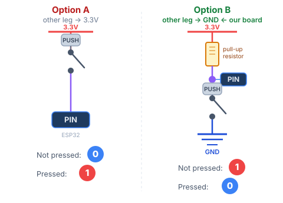

# STEM Club — MicroPython Workshop

## Welcome!

When you sit down, look at the screen on your board. It says **"Hello, [your name]!"** — that was already programmed for you.

Today you will change that program yourself, and build three things:

1. **Robot Eyes** — animated eyes on the screen that react to buttons
2. **Musical Buzzer** — compose your own song and play it with a button
3. **WiFi Robot** — control the robot from your phone over WiFi

You will write code in **MicroPython** — a version of Python that runs on tiny computers like your ESP32. The boards are already set up and ready to go. No installation needed.

---

## Your hardware

| Part | What it does |
|------|-------------|
| **ESP32** | The brain — a tiny computer running your Python code |
| **OLED screen** | A small display with a yellow strip at the top and blue area below |
| **Buzzer** | Makes sounds |
| **Button 1** | Left button |
| **Button 2** | Right button |

---

## How to edit and upload code — using Thonny

**Thonny** is a beginner-friendly code editor that talks directly to your ESP32. Here is how to use it:

### 1. Open Thonny

Look for **Thonny** in your application menu, or type `thonny` in the terminal.

### 2. Connect to your board

At the bottom-right corner of the window you will see the interpreter. Click it and choose:

> **MicroPython (ESP32)** — then select the correct port (your tutor will help)

The bottom panel will show `>>>` — that means Thonny is talking to your board.

### 3. Open the file panel

Go to **View → Files**. Two panels appear:
- **Top panel** — files on this computer
- **Bottom panel** — files on your ESP32

### 4. Edit your code

In the bottom panel (ESP32), double-click **main.py** to open it. Make your changes in the editor.

### 5. Save and run

Press **Ctrl + S** to save your changes directly to the board.
Then press the **Stop/Restart** button (or press **F5**) to run your updated code.

That's it — no terminal commands needed!

---

## Exercise 1 — Robot Eyes 👀

### What you will build

Animated robot eyes on the OLED screen that show a mood you choose.

### Walk through the code

Open **main.py** from the ESP32 in Thonny and read through it from top to bottom. Here is what each section does:

**1. Imports** — load the libraries that give us the screen and eye animation.

**2. Screen setup** — connect to the display over two wires (SDA and SCL) and set up the drawing area.

**3. Robot eyes setup** — create the animation and tell it to blink automatically.

**4. Your turn** — one line to change (see below).

**5. Main loop** — runs forever, drawing the next animation frame.

---

### Your task — choose an emotion

Find this line at the bottom of the setup:

```python
EMOTION = DEFAULT   # <-- change this!
```

Replace `DEFAULT` with one of these:

| Name | What it looks like |
|------|--------------------|
| `DEFAULT` | Calm, neutral eyes |
| `HAPPY` | Big, round friendly eyes |
| `TIRED` | Droopy eyelids |
| `ANGRY` | Frowning, narrowed eyes |
| `CURIOUS` | One eye bigger than the other |

Save (**Ctrl + S**) and restart. See the eyes change!

---

### Part 2 — add buttons (type this yourself!)

Now you will wire two buttons and make them switch emotions. Your tutor will help you connect the buttons to the board.

**How does a button work?**

Every pin on the ESP32 reads a **digital signal** — a value that is always either:

- **1** (HIGH) — the pin has voltage (~3.3 V)
- **0** (LOW) — the pin has no voltage (0 V, same as GND)

A button is a simple switch. It connects two points together when pressed.
Where you connect the other leg of the button decides what signal you read:

| Other leg connected to | Not pressed | Pressed |
|------------------------|-------------|---------|
| VCC (3.3 V) | 0 | **1** |
| GND (0 V)   | 1 | **0** |



Our buttons are wired to **GND**. The ESP32 has a built-in pull-up resistor that holds the pin at **1** when the button is open.

**Add this code** just before the `while True:` loop:

```python
button1 = Pin(16, Pin.IN, Pin.PULL_UP)   # left button
button2 = Pin(17, Pin.IN, Pin.PULL_UP)   # right button

PRESSED = ???      # <-- 0 or 1? think about the wiring!
EMOTION_1 = HAPPY
EMOTION_2 = ANGRY
```

**Add this inside the loop** (indented with 4 spaces):

```python
    if button1.value() == PRESSED:
        robo.mood = EMOTION_1

    if button2.value() == PRESSED:
        robo.mood = EMOTION_2
```

Save and restart. Press the buttons!

### Stuck?

Your tutor can switch you to the `robo_eyes_solution` branch where the full solution is ready.

---

## Exercise 2 — Musical Buzzer 🎵

### What you will build

Button 1 plays a short beep. Button 2 plays a song you write yourself!

### Note cheat sheet

```
C  D  E  F  G  A  B       ← normal octave
c  d  e  f  g  a          ← one octave higher (lowercase)
_                          ← silence / pause
```

### Finding your melody

Go to **[noobnotes.net](https://noobnotes.net)** and search for your favourite song. The site shows you the letter names of the notes.

Copy the letters directly — just wrap each one in quotes: `C` → `'C'`. Use lowercase for the higher notes: `c d e f g a`.

### Your task

Switch to the `musical_buzzer_exercise` branch, then open **main.py** from the ESP32. Find this section:

```python
MY_MELODY = [
    # Write your notes here! ↓
    ('C', 0.3),
]
```

Replace the example with your own notes. Each entry is `('NOTE', duration)`:

```python
MY_MELODY = [
    ('E', 0.3),   # short E
    ('D', 0.3),   # short D
    ('C', 0.6),   # long  C
    ('_', 0.2),   # pause
]
```

Durations: `0.2` = short · `0.4` = medium · `0.6` = long

Save and restart. Press button 2 to hear your song!

### Stuck?

Your tutor can switch you to `musical_buzzer_solution` — it has a full Twinkle Twinkle Little Star as an example.

---

## Exercise 3 — WiFi Robot 🌐

### What you will build

Your ESP32 creates its own WiFi network. Connect to it with your phone, open a webpage, and control the robot's mood — and play sounds — from your browser.

### Your task

Switch to the `wifi_robot_exercise` branch, then open **main.py** from the ESP32.

**Step 1 — Give your robot a WiFi name:**

```python
WIFI_NAME = 'STEM-Club'    # <-- change this!
```

Pick something creative. This is the network name people see on their phone.

**Step 2 — Fill in the missing emotions:**

```python
MOODS = {
    'neutral': DEFAULT,
    'happy':   XXX,        # <-- fill in the emotion
    'tired':   TIRED,
    'angry':   XXX,        # <-- fill in the emotion
    'curious': CURIOUS,
}
```

Replace `XXX` with the correct emotion from Exercise 1.

**Step 3 — Test it:**

1. Save and restart
2. On your phone, go to **WiFi settings** and connect to your robot's network (password: `12345678`)
3. Open a browser and go to **192.168.4.1**
4. Tap the mood buttons and watch the eyes change!

### Stuck?

Your tutor can switch you to `wifi_robot_solution`.

---

## Bonus — 3D Modelling 🖨️

Finished early? Your tutor will show you how to design a case for your robot in 3D modelling software — and how that design gets printed into a real object.

---

## Quick reference

### Note names
```
C  D  E  F  G  A  B   ← letter (add 4 or 5)
Do Re Mi Fa Sol La Si  ← solfège
```

### Durations
```
0.2 = short    0.4 = medium    0.6 = long    0.1 = very short
```

### Emotions
```
DEFAULT   HAPPY   TIRED   ANGRY   CURIOUS
```
