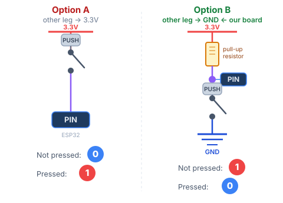
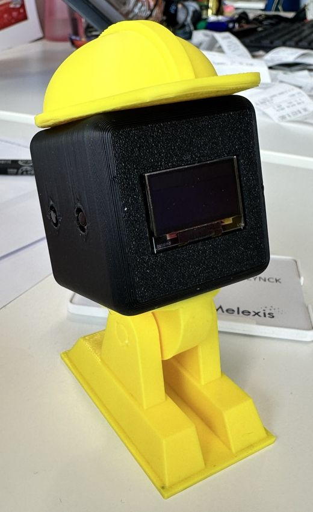

# STEM Club — MicroPython-workshop

🇬🇧 English version: [WORKSHOP.md](WORKSHOP.md)

## Welkom!

Als je gaat zitten, kijk dan naar het scherm op je bordje. Er staat **"Hello, <NAME>!"**. Het bordje kent jouw naam nog niet. Je eerste opdracht is het die naam aanleren!

Daarna bouw je drie dingen:

1. **Robotogen** — bewegende ogen op het scherm die reageren op knoppen
2. **Muzikale zoemer** — maak je eigen liedje en speel het af met een knop
3. **Wifi-robot** — bestuur de robot met je gsm via wifi

Ben je vroeg klaar? Er is nog een vierde opdracht, als je wilt: **ontwerp een hoed voor je robot** en laat hem 3D-printen!

Je schrijft code in **MicroPython** — een versie van Python die draait op kleine computertjes zoals jouw ESP32. De bordjes zijn al klaargezet en klaar voor gebruik. Je hoeft niets te installeren.

---

## Je hardware

| Onderdeel | Wat het doet |
|------|-------------|
| **ESP32** | Het brein — een kleine computer waarop jouw Python-code draait |
| **OLED-scherm** | Een klein scherm met een gele strook bovenaan en een blauw deel eronder |
| **Zoemer** | Maakt geluid |
| **Knop 1** | Linkse knop |
| **Knop 2** | Rechtse knop |

---

## Code aanpassen en uploaden — met Thonny

**Thonny** is een programma om code te schrijven dat makkelijk is voor beginners. Het praat rechtstreeks met je ESP32. Zo gebruik je het:

### 1. Open Thonny

Zoek **Thonny** in het menu met programma's, of typ `thonny` in de terminal.

### 2. Maak verbinding met je bordje

Rechtsonder in het venster zie je de interpreter. Klik erop en kies:

> **MicroPython (ESP32)** — kies daarna de juiste poort (je begeleider helpt je)

In het onderste paneel verschijnt `>>>` — dat betekent dat Thonny met je bordje praat.

### 3. Open het bestandenpaneel

Ga naar **View → Files**. Er verschijnen twee panelen:
- **Bovenste paneel** — bestanden op deze computer
- **Onderste paneel** — bestanden op je ESP32

### 4. Pas je code aan

Dubbelklik in het onderste paneel (ESP32) op **main.py** om het te openen. Maak je aanpassingen in de editor.

### 5. Opslaan en uitvoeren

Druk op **Ctrl + S** om je aanpassingen meteen op het bordje op te slaan.
Druk daarna op de knop **Stop/Restart** (of druk op **F5**) om je nieuwe code uit te voeren.

Dat is alles! Je gebruikt de terminal alleen om een nieuwe oefening te laden, en dat doe je samen met je begeleider.

---

## Opwarmer — zet je naam op het scherm 👋

1. Open in Thonny **main.py** van de ESP32 (onderste paneel).
2. Zoek deze regel:
   ```python
   NAME = "<NAME>"  # <-- change this to your name
   ```
3. Vervang `<NAME>` door je voornaam. **Laat de aanhalingstekens `" "` staan!**
   ```python
   NAME = "Henry"  # <-- change this to your name
   ```
4. Druk op **Ctrl + S** om op te slaan, en daarna op **F5** om het uit te voeren.

✅ **Het is gelukt als:** het scherm **Hello, Henry!** toont, met jouw naam.

> 💡 Er passen ongeveer 15 letters op het scherm, en het kan geen accenten tonen (é, ë…). Gebruik je voornaam, geschreven zonder accenten.

---

## Oefening 1 — Robotogen 👀

### ✋ Voor je begint — laad de code van Oefening 1

**Wacht op je begeleider.** We doen deze stap allemaal samen, of je begeleider helpt je.

1. Open een terminal in de map van de workshop (`STEM_ESP32_ROBOT`) en typ:
   ```bash
   git checkout robo_eyes_exercise
   ```
2. Dubbelklik in Thonny op **main.py** in het **bovenste paneel** (deze computer).
3. Klik op **File → Save as… → MicroPython device** en sla het op als **main.py** (zeg ja om het oude bestand te vervangen).
4. Druk op **Stop/Restart** (of **F5**).

✅ **Het is gelukt als:** er twee robotogen verschijnen in het blauwe deel van het scherm en ze knipperen.

### Wat je gaat bouwen

Bewegende robotogen op het OLED-scherm die een gevoel tonen dat jij kiest.

### Loop de code door

Open **main.py** van de ESP32 in Thonny en lees het van boven naar onder. Dit doet elk stuk:

**1. Imports** — laad de bibliotheken die ons het scherm en de oogbewegingen geven.

**2. Scherm instellen** — maak verbinding met het scherm via twee draden (SDA en SCL) en stel de tekenruimte in.

**3. Robotogen instellen** — maak de animatie en zeg dat ze vanzelf moet knipperen.

**4. Jouw beurt** — één regel om aan te passen (zie hieronder).

**5. Hoofdlus** — loopt voor altijd door en tekent telkens het volgende beeldje van de animatie.

---

### Jouw opdracht — kies een gevoel

Zoek deze regel onderaan het instelgedeelte:

```python
EMOTION = DEFAULT   # <-- change this!
```

Vervang `DEFAULT` door een van deze:

| Naam | Hoe het eruitziet |
|------|--------------------|
| `DEFAULT` | Rustige, gewone ogen |
| `HAPPY` | Grote, ronde, vriendelijke ogen |
| `TIRED` | Hangende oogleden |
| `ANGRY` | Fronsende, toegeknepen ogen |
| `CURIOUS` | Eén oog groter dan het andere |

> 💡 Typ het gevoel in **HOOFDLETTERS**, precies zoals in de tabel: `HAPPY`, niet `happy`. Voor Python zijn dat twee verschillende woorden.

Sla op (**Ctrl + S**) en herstart. Kijk hoe de ogen veranderen!

---

### Deel 2 — voeg knoppen toe (typ dit zelf!)

Nu sluit je twee knoppen aan en laat je ze van gevoel wisselen. Je begeleider helpt je om de knoppen op het bordje aan te sluiten.

**Hoe werkt een knop?**

Elke pin van de ESP32 leest een **digitaal signaal** — een waarde die altijd ofwel:

- **1** (HIGH) is — er staat spanning op de pin (~3,3 V)
- **0** (LOW) is — er staat geen spanning op de pin (0 V, hetzelfde als GND)

Een knop is een eenvoudige schakelaar. Als je erop drukt, verbindt hij twee punten met elkaar.
Waar je het andere pootje van de knop aansluit, bepaalt welk signaal je leest:

| Ander pootje aangesloten op | Niet ingedrukt | Ingedrukt |
|------------------------|-------------|---------|
| VCC (3,3 V) | 0 | **1** |
| GND (0 V)   | 1 | **0** |



Onze knoppen zijn aangesloten op **GND**. De ESP32 heeft een ingebouwde pull-upweerstand die de pin op **1** houdt als de knop niet ingedrukt is.

**Stap 1 — Typ deze code** op de lege regel net boven `# --- Main loop ---`:

```python
button1 = Pin(16, Pin.IN, Pin.PULL_UP)   # left button
button2 = Pin(17, Pin.IN, Pin.PULL_UP)   # right button

PRESSED = ???      # <-- 0 or 1? think about the wiring!
EMOTION_1 = HAPPY
EMOTION_2 = ANGRY
```

Vervang nu `???` door **0** of **1**. Welke is juist? Kijk naar de tabel hierboven. Onze knoppen zijn aangesloten op **GND**.

> ⚠️ Koos je `HAPPY` of `ANGRY` in Deel 1? Dan lijkt het alsof die knop niets doet, want de ogen zien er al zo uit! Verander `EMOTION_1` of `EMOTION_2` in een ander gevoel.

**Stap 2 — Zet de code van de knoppen aan.** Onderaan het bestand, in de lus, vind je deze regels:

```python
    #if button1.value() == PRESSED:
    #    robo.mood = EMOTION_1
    #if button2.value() == PRESSED:
    #    robo.mood = EMOTION_2
```

De `#` zet een regel uit, zodat de computer hem overslaat. Haal **alleen de `#`** weg aan het begin van elk van de 4 regels. Wis geen spaties, want de spaties vertellen Python welke regels bij elkaar horen.

Sla op en herstart. Druk op de knoppen!

### Zit je vast?

Je begeleider kan je overzetten naar de branch `robo_eyes_solution`, waar de volledige oplossing klaarstaat.

---

## Oefening 2 — Muzikale zoemer 🎵

### ✋ Voor je begint — laad de code van Oefening 2

**Wacht op je begeleider.** We doen deze stap allemaal samen, of je begeleider helpt je.

1. Open een terminal in de map van de workshop (`STEM_ESP32_ROBOT`) en typ:
   ```bash
   git checkout musical_buzzer_exercise
   ```
2. Dubbelklik in Thonny op **main.py** in het **bovenste paneel** (deze computer).
3. Klik op **File → Save as… → MicroPython device** en sla het op als **main.py** (zeg ja om het oude bestand te vervangen).
4. Druk op **Stop/Restart** (of **F5**).

✅ **Het is gelukt als:** de knoppen nog niets doen, en dat is goed, want dat los je op in Opdracht 1. Om het te controleren, open je **main.py** van de ESP32 (onderste paneel). Je zou de regel `BEEP_NOTE = 'A'` moeten vinden.

### Wat je gaat bouwen

Knop 1 speelt een korte piep. Knop 2 speelt een liedje dat je zelf schrijft!

### Spiekbriefje met noten

Schrijf de noten **precies zoals noobnotes.net ze toont**, met het teken ervoor als er een staat:

```
.C  .D  .E  .F  .G  .A  .B     ← low notes (dot in front)
 C   D   E   F   G   A   B     ← middle notes
^C  ^D  ^E  ^F  ^G  ^A  ^B     ← high notes (^ in front)
*C  *D  *E  *F  *G  *A  *B     ← very high notes (* in front)
F#  ^C#  Bb                    ← sharps (#) and flats (b) work too
_                              ← silence / pause
```

Gebruik altijd **HOOFDLETTERS** (`^D`, niet `^d`). noobnotes gebruikt `-` om noten aan elkaar te hangen. Laat die weg.

### Opdracht 1 — Sluit de knoppen aan

De knoppen doen nog niets! Zoek de lus `while True:` onderaan. Vervang elke `pass` door de juiste functie, `beep()` of `play_melody()`:

```python
while True:
    if button1.value() == 0:
        pass           # <-- call beep() or play_melody()
        time.sleep(0.2)
    if button2.value() == 0:
        pass           # <-- call beep() or play_melody()
        time.sleep(0.5)
```

Knop 1 (links) moet **piepen**, en knop 2 (rechts) moet de **melodie** spelen. Sla op en herstart. Maken beide knoppen geluid?

### Opdracht 2 — Kies je piepnoot

Zoek deze regel en verander `'A'` in een noot naar keuze van het spiekbriefje:

```python
BEEP_NOTE = 'A'   # <-- change this!
```

Sla op, herstart en druk op **knop 1** om je piep te horen.

### Opdracht 3 — Raad het mysterieliedje, en schrijf dan je eigen liedje

Druk op **knop 2**. Er speelt een liedje. Kun je raden welk liedje het is?

Heb je het gehoord? Vervang het dan door je eigen liedje. Een script op de computer zet een liedje van noobnotes.net voor jou om in code:

1. Ga naar **[noobnotes.net](https://noobnotes.net)**, zoek een liedje dat je leuk vindt en kopieer het adres van die pagina uit de adresbalk.
2. Open een terminal en voer het script uit met dat adres, bijvoorbeeld:

   ```bash
   cd ~/STEM_ESP32_ROBOT
   python3 scripts/noobnotes_to_melody.py https://noobnotes.net/do-re-mi-sound-of-music/
   ```

3. Het toont de eerste 20 seconden van het liedje, zo:

   ```python
   MY_MELODY = [
       ('C',0.4),('D',0.4),('E',0.4),('C',0.4),('E',0.2),('C',0.2),('E',0.6),('_',0.2),  # Doe, a deer, a female deer
       ...
   ]
   ```

   Kopieer alles van `MY_MELODY = [` tot `]`. Selecteer in main.py de oude `MY_MELODY = [ ... ]` en plak er je liedje overheen.
4. Sla op, herstart en druk op **knop 2**. Klinkt het als jouw liedje?

De getallen zeggen hoe lang elke noot speelt: `0.2` = kort · `0.4` = middellang · `0.6` = lang. Het script gokt ze, dus maak sommige noten langer of korter als het ritme niet juist klinkt.

**Wil je het met de hand proberen?** Elke noot schrijf je precies zoals noobnotes ze toont. noobnotes toont Happy Birthday bijvoorbeeld zo:

```
D - D   E  -  D   G   F#
Happy birthday to you
```

Dus typ je:

```python
MY_MELODY = [
    ('D', 0.2),    # short
    ('D', 0.2),    # short
    ('E', 0.4),    # medium
    ('D', 0.4),    # medium
    ('G', 0.4),    # medium
    ('F#', 0.6),   # long, F sharp
    ('_', 0.2),    # pause
]
```

> 💡 Speelt een noot niet? Kijk dan naar het onderste paneel in Thonny. Daar staat `Unknown note:` en de noot die het niet begreep.

### Zit je vast?

Je begeleider kan je overzetten naar `musical_buzzer_solution` — daarin staat het volledige mysterieliedje als voorbeeld.

---

## Oefening 3 — Wifi-robot 🌐

### ✋ Voor je begint — laad de code van Oefening 3

**Wacht op je begeleider.** We doen deze stap allemaal samen, of je begeleider helpt je.

1. Open een terminal in de map van de workshop (`STEM_ESP32_ROBOT`) en typ:
   ```bash
   git checkout wifi_robot_exercise
   ```
2. Dubbelklik in Thonny op **main.py** in het **bovenste paneel** (deze computer).
3. Klik op **File → Save as… → MicroPython device** en sla het op als **main.py** (zeg ja om het oude bestand te vervangen).
4. Druk op **Stop/Restart** (of **F5**).

✅ **Het is gelukt als:** Thonny een rode foutmelding toont met `name 'XXX' isn't defined`. Dat is normaal. De `XXX` zijn de gaten die je invult in Stap 2.

### Wat je gaat bouwen

Je ESP32 maakt zijn eigen wifinetwerk. Maak er verbinding mee met je gsm, open een webpagina, en bestuur het gevoel van de robot — en speel geluiden af — vanuit je browser.

### Jouw opdracht

Open **main.py** van de ESP32 (onderste paneel).

**Stap 1 — Geef je robot een wifinaam:**

```python
WIFI_NAME = 'Robot-' + BOARD_ID    # <-- change this!
```

Vervang `Robot-` door je eigen naam, bijvoorbeeld `'Sam-'`. Dit is de netwerknaam die mensen op hun gsm zien. `BOARD_ID` voegt 4 letters en cijfers toe die alleen jouw bordje heeft, zodat niemand anders in de klas dezelfde naam krijgt. De wifinaam van je robot wordt dan bijvoorbeeld **Sam-3fa9**.

> ⚠️ Verander alleen de tekst tussen de aanhalingstekens `' '`. Gebruik alleen letters, cijfers en `-`. Geen apostrof: `'Sam's robot'` maakt de code kapot!

**Stap 2 — Vul de ontbrekende gevoelens in:**

```python
MOODS = {
    'neutral': DEFAULT,
    'happy':   XXX,        # <-- fill in the emotion
    'tired':   TIRED,
    'angry':   XXX,        # <-- fill in the emotion
    'curious': CURIOUS,
}
```

Vervang `XXX` door het juiste gevoel uit Oefening 1.

**Stap 3 — Test het:**

1. Sla op en herstart. De wifinaam van je robot staat nu in de **gele strook** bovenaan het scherm.
2. Ga op je gsm naar de **wifi-instellingen** en tik op de naam uit de gele strook. Wachtwoord: `12345678`.
3. Zegt je gsm **"Geen internet"** (of **"No internet"**)? Dat is normaal: de robot is niet met het internet verbonden. Tik op **Verbonden blijven** (of **Behouden** / **Ja**, in het Engels **Stay connected** / **Keep** / **Yes**). Springt je gsm steeds naar een ander netwerk? Zet dan je **mobiele data** uit.
4. Open een browser. Tik op de **adresbalk helemaal bovenaan** (niet op een zoekvak van Google) en typ precies: **http://192.168.4.1**
5. Tik op de gevoelknoppen en kijk hoe de ogen veranderen!

**Stap 4 — Leer je robot de tijd aflezen:**

Je robot kan een klok worden, maar hij telt alleen **seconden**. Jij moet hem leren hoe lang een minuut en een uur zijn. Zoek deze regels in main.py:

```python
SECONDS_PER_MINUTE = 1     # <-- change this!
SECONDS_PER_HOUR   = 1     # <-- change this!
```

1. Hoeveel seconden zitten er in één minuut? En hoeveel seconden zitten er in één uur? Typ je antwoorden in de plaats van de `1`'en.
2. Sla op en herstart. Maak opnieuw verbinding met de wifi van je robot en open **http://192.168.4.1**.
3. Naast de knop **Clock** heeft je gsm het huidige uur al ingevuld. Tik op **Clock**. De ogen veranderen in een grote klok!
4. Klopt je klok? Kijk er een minuut naar. De minuten moeten één keer per minuut omhooggaan, niet elke seconde.
5. Tik op een gevoelknop om de ogen terug te krijgen.

> 💡 Gaat je klok veel te snel, of toont hij een raar uur? Kijk nog eens naar je twee getallen. Een uur heeft 60 minuten, en elke minuut heeft... hoeveel seconden?

> 💡 Als de robot herstart, vergeet hij het uur en toont hij weer zijn ogen. Tik dan gewoon opnieuw op **Clock** op de webpagina.

**Bonusstap (als je wilt) — Speel je eigen liedje:**

Nu speelt **Play Song** het liedje Twinkle Twinkle Little Star. Laat je robot in de plaats je liedje uit Oefening 2 spelen!

1. Haal de `MY_MELODY = [ ... ]` van je liedje opnieuw op. Voer het script uit Oefening 2 uit met het noobnotes.net-adres van je liedje:
   ```bash
   cd ~/STEM_ESP32_ROBOT
   python3 scripts/noobnotes_to_melody.py https://noobnotes.net/do-re-mi-sound-of-music/
   ```
2. Zoek in main.py `MY_MELODY = [` (net onder de commentaarregel met **BONUS**). Selecteer alles van `MY_MELODY = [` tot de bijhorende `]` en plak je liedje erover.
3. Sla op en herstart. Maak opnieuw verbinding met de wifi van je robot en tik op **Play Song**.

### Zit je vast?

Je begeleider kan je overzetten naar `wifi_robot_solution`.

---

## Oefening 4 (als je wilt) — Een hoed voor je robot ⛑️

Deze keer geen code! Je ontwerpt een hoed in 3D op de computer, en je begeleider print hem echt in 3D.

### Wat je gaat bouwen

Een hoed die op het hoofd van je robot klikt. Hier is een voorbeeld, een gele bouwhelm:



Je kunt alles maken: een kroon, een pet, een tovenaarshoed, een hoed met je naam erop.

Onder elke hoed zit een klein **pinnetje** in de vorm van een plus (**+**). Het klikt in het gat bovenop het hoofd van je robot, zodat de hoed blijft zitten. Wees zo creatief als je wilt, zolang het pinnetje er maar is.

Het hoofd van je robot is een kubus van **45 mm** (millimeter) aan elke kant. Alle maten hieronder zijn in mm.

### Stap 1 — Open Tinkercad

1. Open een webbrowser en ga naar **tinkercad.com**
2. Klik op **Log in** → **Students, join your class** en typ de **klascode** die je van je begeleider krijgt, en daarna je bijnaam
3. Klik op **Create** → **3D Design**

**Rondkijken:** sleep met de **rechtse** muisknop om het beeld te draaien, scrol om in en uit te zoomen. Een fout gemaakt? **Ctrl+Z** maakt het ongedaan.

**De grootte van een vorm veranderen:** klik op de vorm, klik daarna op een van de kleine witte vierkantjes aan de zijkanten en typ het getal.

### Stap 2 — Begin met het pinnetje en de koepel

Het pinnetje is al klaar. Bouw het niet zelf: het moet precies de juiste grootte hebben om in je robot te klikken.

1. Klik op **Import** (rechtsboven) → **Choose a file**. Open de map **STEM_ESP32_ROBOT**, kies **hat_peg.stl** en klik op **Import**. Er verschijnt een kleine grijze **+** op het raster.
2. Sleep vanuit **Basic Shapes** aan de rechterkant een **Half Sphere** op het raster. Dit is de bovenkant van de helm. Maak hem **45** breed, **45** lang en **22.5** hoog.
3. Til de koepel op: laat hem geselecteerd en druk **4 keer** op **Ctrl+↑** (Ctrl en het pijltje omhoog). Hij zweeft nu 4 mm boven het raster.
4. Zet het pinnetje onder het midden van de koepel: selecteer ze allebei (sleep een kader rond ze), klik op **Align** (of druk op **L**), en klik op het middelste bolletje van de twee lijnen die **plat** op het raster liggen. Klik niet op de bolletjes van de rechtopstaande lijn.
5. Laat ze allebei geselecteerd en **Group** ze (**Ctrl+G**).

> Maak het pinnetje niet groter of kleiner! Als het van grootte verandert, past de hoed niet op je robot.

### Stap 3 — Voeg de rand toe

1. Sleep een **Cylinder** op het raster. Maak hem **60** breed, **60** lang en **2** hoog.
2. Til hem ook **4 mm** op: 4 keer **Ctrl+↑**.
3. Selecteer de rand en de koepel, klik op **Align**, en klik opnieuw op het middelste bolletje van de twee platte lijnen. Nu zit de rand precies onder de koepel.
4. Wil je een bouwhelm met een klep vooraan? Klik alleen op de rand en druk een paar keer op het pijltje om hem naar voren te schuiven.

### Stap 4 — Maak hem helemaal van jou

Voeg dingen toe aan je hoed: een **Star**, een **Heart**, een **Sphere** als pompon, een **Box** als klep, of **Text** met je naam. Als je een vorm op de hoed sleept, blijft hij eraan plakken. Elke vorm heeft ook kleuren, maar de printer print in één kleur.

Volg deze **printerregels**, anders wordt je hoed niet goed geprint:

- **Laat het pinnetje met rust:** het pinnetje is het enige onder de rand, en het blijft in het midden.
- **Niet te groot:** maximaal **65** breed en lang, en **40** hoog.
- **Niets dat zweeft:** elk deel raakt een ander deel. Een ster die in de lucht zweeft, valt eraf.
- **Niet te dun:** wanden en letters minstens **2 mm** dik.

Ben je klaar? Selecteer dan alles (**Ctrl+A**) en **Group** het (**Ctrl+G**).

### Stap 5 — Stuur hem naar de printer

1. Klik op de naam linksboven (zoals *Brilliant Blorr*) en verander hem in je eigen naam.
2. Klik op **Export** (rechtsboven) → **.STL**.
3. Geef het bestand aan je begeleider.

✅ **Het is gelukt als:** alle delen samen bewegen wanneer je je hoed versleept, en als je het beeld draait om van onderen te kijken, het **+**-pinnetje in het midden van de koepel uitsteekt.

Printen duurt een tijdje, dus je krijgt je hoed waarschijnlijk bij de volgende sessie.

---

## Snel opzoeken

### Notennamen
```
.C  C  ^C  *C   ← low · middle · high · very high (as on noobnotes.net)
C  D  E  F  G  A  B     ← letter
Do Re Mi Fa Sol La Si   ← solfège
```

### Notenlengtes
```
0.2 = short    0.4 = medium    0.6 = long    0.1 = very short
```

### Gevoelens
```
DEFAULT   HAPPY   TIRED   ANGRY   CURIOUS
```
